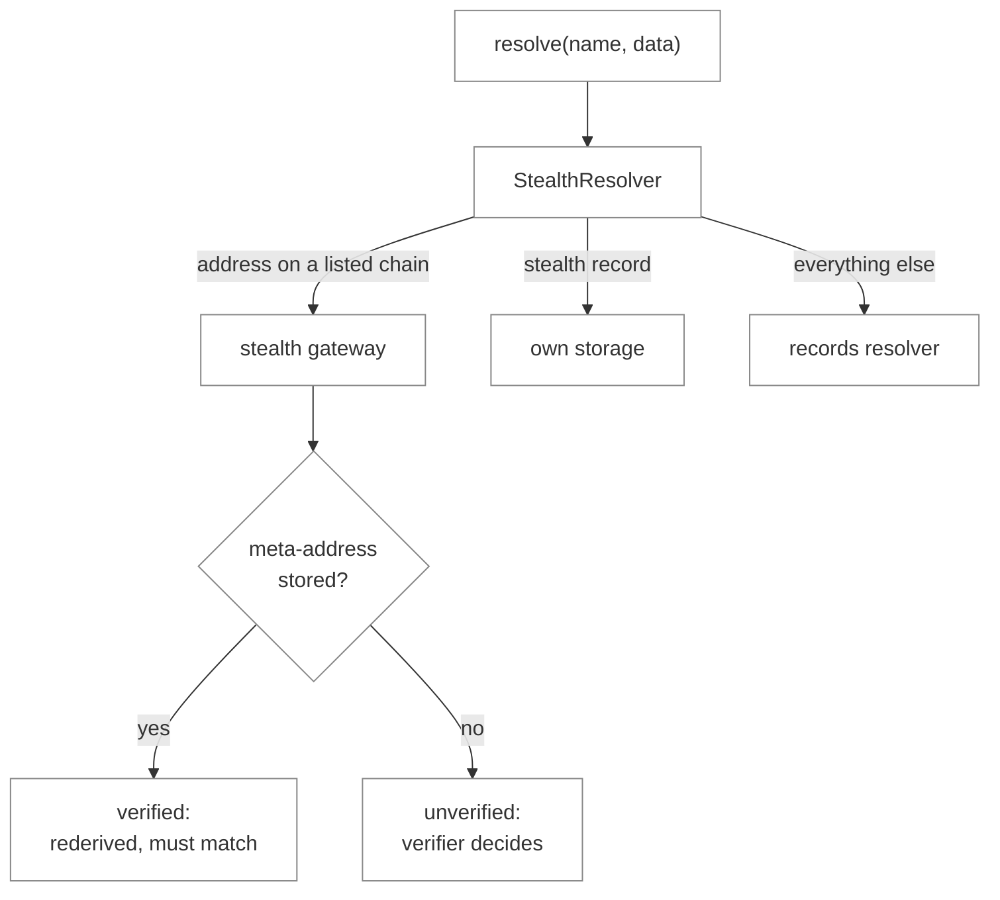

# Stealth ENS Resolver

> [!WARNING]
> Work in progress, not audited, not deployed.

Reference contracts for ENSIP-30, stealth address resolution
([ensdomains/ensips#88](https://github.com/ensdomains/ensips/pull/88)). A name that uses
`StealthResolver` resolves to a fresh ERC-5564 stealth address on every lookup. If the name
publishes a stealth meta-address, the address the gateway returns is verified onchain against it
before resolution completes.

## How it works

`StealthResolver` is set as the name's resolver in the ENSv2 registry. It is immutable and verifies
exactly one scheme: there is one deployment per scheme, each with that scheme's verifier fixed at
deployment. For each name it stores a stealth meta-address and a small config: a records
resolver, gateway URLs and a chain list. All other records stay in the records resolver, an
unmodified ENS resolver chosen by the owner (for example the `PermissionedResolver` ENSv2 gives new
names), and queries for them are forwarded there.



- **Address on a listed chain** (coin type on the chain list, gateway URLs set). The client is sent
  to the stealth gateway through ERC-3668 (CCIP-Read). If the name has a meta-address, the callback
  rederives the address and rejects one that does not match (**verified**). Otherwise the scheme's
  verifier decides what to accept (**unverified**).
- **Address on any other chain, or no gateway URLs.** Forwarded, so a name can be stealth on Base and
  keep a static address on Ethereum.
- **Stealth record**, `data(node, "stealth-meta-address[<scheme>][<coinType>]")`. Answered from
  storage for listed chains: the same value the callback verifies against.
- **Everything else.** Forwarded to the records resolver.

Queries arrive through ENSIP-10 `resolve(name, data)`, as the UniversalResolver sends them, batched
`multicall`s included. A wildcard name, such as a username that exists only in its parent's
gateway, uses the config and records of its nearest registered ancestor; a registered name uses only
its own. The ENSIP's Section 5 functions are therefore answered through `resolve()` only. Contracts
verify a resolution onchain with `UniversalResolverV2.resolve(name, verifyStealthResolution(...))`.

## Who controls a name

State is written by whoever may set the name's resolver in the ENSv2 registry (`ROLE_SET_RESOLVER`),
applied to the nearest registered name at or above it. A parent such as `wallet.eth` therefore writes
the meta-addresses of its wildcard usernames; once a username is registered, only its holder (and
any registry-wide `ROLE_SET_RESOLVER` holder) writes it. A parent that can still change a name's
registry entry governs that name anyway, as the ENSIP's trust model says.

A name registered again after it expired starts empty. A transferred name keeps its state, as ENS
records do, until the new holder calls `clearRecords(name)`.

Whether a lookup that goes to the gateway is verified depends only on whether a meta-address is
stored for the name; who may store one depends only on whether the name is registered. Under one
parent every combination coexists:

| Name | Registered | Meta-address | Result |
|---|---|---|---|
| `alice.wallet.eth` | yes, Alice holds the token | yes, by Alice | Verified, with Alice's own records resolver, gateway URLs and chain list |
| `bob.wallet.eth` | no, exists only in the gateway | no | Unverified, with `wallet.eth`'s config; the verifier's own checks apply |
| `carol.wallet.eth` | no | yes, by `wallet.eth`'s holder | Verified, with the parent as the trusted writer of the record |
| `dave.wallet.eth` | yes, Dave holds the token | no | Unverified on chains Dave lists with his own gateway URLs; otherwise forwarded to his records resolver (static addresses, or unset) |

## Setting up a name

Every step is per name: `StealthResolver` itself is deployed once per scheme, and nothing in it is
configured per resolver. A registered name's config and chain list also cover the wildcard names
below it. If `wallet.eth` sets them, `user.wallet.eth` needs no setup of its own as long as it is
not registered: it uses `wallet.eth`'s config and chain list, and `wallet.eth` writes its
meta-address. Once `user.wallet.eth` is registered it inherits nothing, and its holder sets up all
five steps for it. A smart account can batch all five.

1. Deploy or reuse a records resolver for the name's other records. One resolver, such as an
   account's `PermissionedResolver`, can hold the records of many names.
2. `setConfig(name, recordsResolver, gatewayURLs)`, per registered name. A wildcard name uses its
   nearest registered ancestor's config.
3. `setChains(name, coinTypes, true)` with the chains the recipient scans, per registered name.
   A wildcard name uses its nearest registered ancestor's chain list.
4. `setMetaAddress(name, value)` for verified resolution, per name, wildcard names included (the
   parent writes those). Without a record, resolution is unverified.
5. Set the name's resolver in the ENSv2 registry to `StealthResolver`, per registered name. Wildcard
   names reach it through their parent's resolver, so a parent sets it once for all of them.

Things to know:

- **Acquired by transfer:** revoke any other `ROLE_SET_RESOLVER` holder on the token (the registry
  keeps the seller's grants), then call `clearRecords(name)`.
- **No default or static address for listed chains in the records resolver.** An ENSIP-19 default
  address answers every EVM coin type without its own record, `0x80000001` included. A static
  address for a listed chain stays readable through forwarded selectors such as `hasAddr` and
  `interfaceImplementer`.
- **The ENSIP-19 default coin type** (`0x80000000`) can be listed as an opt-in, for wallets that ask
  only for the default. The answer names no chain, so the payer may use it on a chain where the
  scheme's address is not the recipient's.
- **Client-side derivation only:** list the chains and set no gateway URLs. One name cannot combine
  the gateway on some chains with client-side derivation only on others.
- **Lapses:** a registered username that expires and is not registered again resolves as a wildcard
  name of its parent, including any record the parent wrote for it before it was registered. A label
  reserved again after its reservation lapsed reads what the previous reservation wrote. In both
  cases, clear the old state.

## Batched lookups

In `resolve(name, multicall(...))` the lookups go through the batch gateways on ENS's list: today
ENS's remote gateway `ccip-v3.ens.xyz` first, then `x-batch-gateway:true`. A client that implements
that marker batches locally; any other sends the whole batch, gateway responses included, to ENS's
gateway. A remote batch gateway can replace the address in unverified mode unless the verifier
authenticates the response, for example by a signature of the stealth gateway; `Scheme1Verifier`
does not. In scheme 1 verified mode it can also answer from an ephemeral key of its own, so that the
recipient never finds the payment. A failed item comes back as error data, marked only by its length
(4 more than a multiple of 32, or empty), so clients check that before decoding an item.

## Schemes

| Verifier | Scheme | Meta-address | `verificationData` |
|---|---|---|---|
| `Scheme1Verifier` | ERC-5564 scheme 1, as the ScopeLift stealth-address SDK derives it | `P_spend ‖ P_view`, 66 bytes | `e ‖ S.x ‖ S.y`, 96 bytes |
| `FluidkeyVerifier` | Fluidkey stealth Safe, FK1 (`0x464B31`), as stealth-account-kit 1.1.1 derives it: a counterfactual 1-of-1 Safe 1.3.0 | `P_spend ‖ configHash`, 65 bytes | verified: `e ‖ S.x ‖ S.y ‖ signature`, 161 bytes; unverified: `abi.encode(uint64 expires, bytes signature)` |

Both verifiers check the derivation with two `ecrecover` calls (`LibEcrecover`, tested against the
construction Chainlink's VRF verifier uses), with no curve library. `verificationData` contains the
ephemeral private key: combined with one leaked stealth private key it gives the spending key, so
stealth keys need the same care as the spending key. With no meta-address, `Scheme1Verifier`
returns the gateway's address unchecked.

FK1:

- **Signed in both modes.** Every response needs an EIP-712 signature by a signer listed in
  `FluidkeySigners`, which Fluidkey owns. The signature is 65 bytes, with `v` 27 or 28 and a low `s`.
  Fluidkey's signing service is therefore on the availability path of every FK1 name. In verified
  mode a signer can refuse a derivation but cannot redirect it. A signed unverified response is
  valid for at most 10 minutes.
- **Chains.** The contract has no chain list: a name gets answers on the chains Fluidkey's gateway
  signs for. Today these are Ethereum, Base, OP Mainnet, Arbitrum One, Polygon PoS, Gnosis and BNB
  Smart Chain, plus the ENSIP-19 default for names that list it. A default answer can be paid on any
  EVM chain, including one where the Safe is not the recipient's: on zkSync-family chains it is out
  of reach, and on a chain without the Safe contracts anyone who saw the lookup can deploy it without
  its setup.
- **Auto-earn.** `configHash` 0 means auto-earn off. Any other value makes the Safe enable Fluidkey's
  Earn module with that config, which lets the relayers appointed by the module's owner, a Fluidkey
  multisig, deposit the Safe's listed tokens into the listed vaults. Those parties are then trusted,
  and the record's writer chooses the `configHash`. The Earn module is not deployed on BNB Smart
  Chain yet; this relies on its address being deployable only by Fluidkey's multisig.
- **Detection.** FK1 records keep the client-side derivation flag clear: Fluidkey finds payments by
  regenerating its own ephemeral keys and cannot detect payments a sender derived.

## Reading a meta-address onchain

`ERC6538Bridge.stealthMetaAddressOf(name, schemeId)` returns a name's meta-address in the shape of
the ERC-6538 registry, for contracts and clients that derive stealth addresses themselves. It reads
the record for coin type 60 through ENS's UniversalResolver, wildcard names included and whatever
resolver serves it, and returns it only if the record permits client-side derivation. Otherwise, or
if the lookup fails or is answered offchain, it returns empty. It takes the DNS-encoded name, so it
is not a drop-in for the ERC-6538 registry, and it never falls back to the registry for a name
without a record.

- **Coin type 60 only.** A name that does not list Ethereum has no record here, including a name
  that lists only the ENSIP-19 default coin type.
- **A malformed name reverts** (`DNSDecodingFailed`) rather than reading as empty: the name is the
  caller's, not part of the lookup.
- **Trust.** The bridge is stateless and has no owner, but it reads through ENS's UniversalResolver
  proxy, which ENS upgrades in place. Its answers depend on ENS's proxy admin, as every lookup
  through the UniversalResolver does. Deploy it against the proxy, not an implementation.

## Contracts

| Contract | Role |
|---|---|
| `StealthResolver` | The verifying resolver |
| `interfaces/IStealthResolver` | ENSIP Section 5, verbatim |
| `interfaces/IStealthVerifier` | Scheme-specific verification, one verifier per scheme |
| `verifiers/Scheme1Verifier` | ERC-5564 scheme 1 |
| `verifiers/FluidkeyVerifier` | Fluidkey stealth Safe, FK1 |
| `verifiers/FluidkeySigners` | Fluidkey gateway signers for FK1, owned by Fluidkey |
| `verifiers/LibEcrecover` | secp256k1 `a·G + b·Q` on `ecrecover`, shared by the verifiers |
| `ERC6538Bridge` | A name's meta-address in ERC-6538's shape, read through the UniversalResolver |

ENS code is used unchanged: `ResolverCaller`, `CCIPReader`, `CCIPBatcher`, `NameCoder` and `ENSIP19`
from ens-contracts; `LibResolution`, `RegistryRolesLib` and the registry interfaces from namechain.

| Contract | Runtime bytes | Margin to 24,576 |
|---|---|---|
| `StealthResolver` | 21,097 | 3,479 |
| `Scheme1Verifier` | 1,657 | 22,919 |
| `FluidkeyVerifier` | 5,543 | 19,033 |
| `FluidkeySigners` | 927 | 23,649 |
| `ERC6538Bridge` | 2,602 | 21,974 |

Gas per path is in `snapshots/Gas.json`, measured by `test/Gas.t.sol` and checked in CI.

## Build and test

Requires [Foundry](https://book.getfoundry.sh/).

```bash
git clone --recurse-submodules <repo>
forge build
forge test
./script/verify-canonical-build.sh
./script/check-ensip-sync.sh
```

The tests run on namechain's own ENSv1 and ENSv2 fixtures, including resolution through
UniversalResolverV2. Three fork tests are pinned to blocks and need archive RPCs: one against ENS's
ENSv2 deployment on Sepolia, one checking `FluidkeyVerifier`'s Safe constants against Ethereum
mainnet, and one reading records through `ERC6538Bridge` and ENS's mainnet UniversalResolver.

```bash
SEPOLIA_RPC_URL=<rpc> MAINNET_RPC_URL=<rpc> forge test --match-path "test/fork/*"
```

- `check-ensip-sync.sh` checks that `IStealthResolver` matches the pinned ENSIP's Section 5
  verbatim (override with `ENSIP_REF`, or point `ENSIP_FILE` at a local draft).
- `verify-canonical-build.sh` checks that this repo compiles ENS's `PublicResolverV2` byte for byte
  as namechain does.
- The test vectors come from the reference implementations: `test/utils/Scheme1Vectors.sol` from the
  ScopeLift SDK, `test/utils/FluidkeyVectors.sol` from Fluidkey's stealth-account-kit. The
  generators are in `script/vectors/`.
- Running a subset of tests rewrites `snapshots/` without the gas file. Run the full suite before
  committing, or restore it with `git checkout snapshots/`.

## Dependencies

| Dependency | Pin |
|---|---|
| [ensdomains/namechain](https://github.com/ensdomains/namechain) | `62778d8`, tag `v2-mainnet-deployment-1` |
| [ensdomains/ens-contracts](https://github.com/ensdomains/ens-contracts) | `121dc23`, the commit namechain pins |
| [OpenZeppelin/openzeppelin-contracts](https://github.com/OpenZeppelin/openzeppelin-contracts) | `e4f7021` (v5) and `54b3f14` (v4), as namechain pins |
| [foundry-rs/forge-std](https://github.com/foundry-rs/forge-std) | latest at setup, tests only |

ens-contracts and OpenZeppelin come from namechain's own submodules, and the compiler settings match
ENSv2's production build (solc 0.8.25, EVM `cancun`, optimizer at 1000 runs).

## Deployment

Each script deploys through the canonical CREATE2 deployer with a fixed salt, so a contract has one
address per set of constructor arguments on every chain. Without `--broadcast` a script only
simulates.

```bash
forge script script/DeployScheme1Verifier.s.sol --fork-url $RPC_URL
```

```bash
SIGNERS_OWNER=<a> SCHEME_ID=4606769 forge script script/DeployFluidkeyVerifier.s.sol --fork-url $RPC_URL
```

```bash
ROOT_REGISTRY=<a> VERIFIER=<a> BATCH_GATEWAY_PROVIDER=<a> forge script script/Deploy.s.sol --fork-url $RPC_URL
```

```bash
UNIVERSAL_RESOLVER=<a> forge script script/DeployERC6538Bridge.s.sol --fork-url $RPC_URL
```

There is one `StealthResolver` per verifier. Deploy `FluidkeyVerifier` only once the scheme's ERC
declares its ID.

## License

[MIT](LICENSE)
